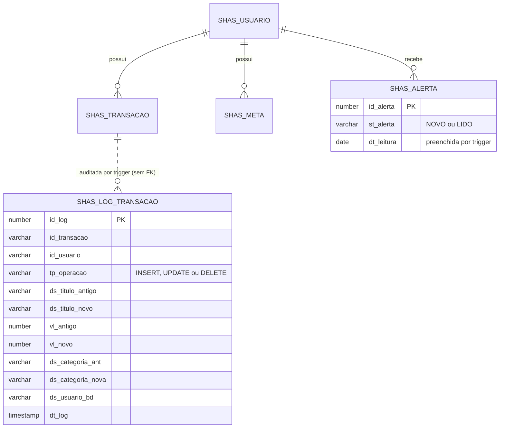

# Smart HAS: camada Oracle PL/SQL

Esta pasta traz a camada de banco **Oracle PL/SQL** do Smart HAS: modelo de dados, carga de dados simulados, **3 packages** (que reúnem as functions e procedures), **2 triggers** (auditoria e automação), rotinas com **Dynamic SQL** e testes integrados. Ela convive com o Firestore: o app continua gravando no Firestore e, quando a integração está ligada, o back-end Java também registra no Oracle cada transação e cada meta nova, e as regras de saldo, alertas e relatórios são calculadas em PL/SQL.

> **Status da integração Java:** o back-end ainda chama as **rotinas soltas** (`03_functions.sql` e `04_procedures.sql`). Elas foram mantidas ao lado dos packages e continuam funcionando. A migração das chamadas do Java para os packages é a etapa seguinte.

## Conteúdo da pasta

| Arquivo | O que faz |
|---|---|
| `01_ddl.sql` | Cria as 4 tabelas, chaves, restrições, índice e comentários |
| `02_dados.sql` | Carga de dados simulados: 3 usuários, 165 transações e 3 metas |
| `03_functions.sql` | As 3 functions soltas, com testes de uso dentro de consultas SQL |
| `04_procedures.sql` | As 3 procedures soltas, com 7 testes e a consulta dos alertas gerados |
| `05_packages.sql` | Os **3 packages** (`PKG_SHAS_CALCULO`, `PKG_SHAS_OPERACAO`, `PKG_SHAS_RELATORIO`), incluindo o **Dynamic SQL**, e a verificação (V1 a V9) |
| `06_triggers.sql` | Tabela `SHAS_LOG_TRANSACAO`, colunas de status do alerta, as **2 triggers** e os testes (terminam em `ROLLBACK`) |
| `07_testes.sql` | Testes integrados que gravam dados de teste e **removem tudo no final** |
| `modelo/DER_SmartHAS.png` | Diagrama entidade-relacionamento (modelo relacional) |

> Os scripts estão **sem acentos de propósito**, para evitar problemas de codificação no SQL Developer.

## Modelo de dados


| Tabela | Descrição |
|---|---|
| `SHAS_USUARIO` | Usuários. A chave `id_usuario` é o **UID do Firebase** |
| `SHAS_TRANSACAO` | Rendas e despesas, com categoria, recorrência e parcelas |
| `SHAS_META` | Metas financeiras do usuário |
| `SHAS_ALERTA` | Alertas gerados pelas rotinas PL/SQL. Possui `ST_ALERTA` (`NOVO`/`LIDO`) e `DT_LEITURA` |
| `SHAS_LOG_TRANSACAO` | **Auditoria** das operações em `SHAS_TRANSACAO` (preenchida por trigger) |

Um usuário tem várias transações, metas e alertas (relacionamentos 1:N). `SHAS_LOG_TRANSACAO` **não tem chave estrangeira** de propósito: o histórico precisa sobreviver à exclusão da transação auditada.



## Como executar

Pré-requisito: Oracle SQL Developer conectado ao Oracle (no ambiente da FIAP: host `oracle.fiap.com.br`, porta `1521`, SID `ORCL`, usuário `RM` + matrícula).

Execute cada arquivo como **script** (F5), nesta ordem:

1. **`01_ddl.sql`**: deve criar as 4 tabelas. Confira com:
   ```sql
   SELECT table_name FROM user_tables WHERE table_name LIKE 'SHAS%';
   ```
2. **`02_dados.sql`**: carrega os dados. A consulta ao final deve mostrar **3 usuários, 165 transações e 3 metas**. Os valores em reais variam a cada carga, porque as despesas são geradas aleatoriamente.
3. **`03_functions.sql`**: compila as 3 functions e roda as consultas de exemplo.
4. **`04_procedures.sql`**: compila as 3 procedures e executa os testes.
5. **`05_packages.sql`**: compila os 3 packages e roda a verificação. Esperado: 6 objetos `VALID` (3 `PACKAGE` e 3 `PACKAGE BODY`) e nenhuma linha em `USER_ERRORS`. Pode ser reexecutado (`CREATE OR REPLACE`).
6. **`06_triggers.sql`**: cria a tabela de log, as colunas de status e as 2 triggers. Pode ser reexecutado (a criação da estrutura é protegida por verificação). Os testes ao final terminam em `ROLLBACK`.
7. **`07_testes.sql`**: rode **inteiro e na mesma sessão**. As procedures dos packages dão `COMMIT`, então o script usa um usuário de teste (`uid-teste-001`) e remove tudo no final.

Para recomeçar do zero, descomente as linhas `DROP TABLE` no início do `01_ddl.sql`.

## Packages

Os packages agrupam as rotinas por assunto, com **specification** (interface pública) e **body** (implementação). Ordem de compilação: `CALCULO`, depois `OPERACAO` e `RELATORIO` (que dependem dele).

### `PKG_SHAS_CALCULO`: cálculos financeiros

| Item | Tipo | O que faz |
|---|---|---|
| `c_limite_alerta` | constante (`0.8`) | Limite de 80% da renda usado nos alertas. Definido em um só lugar |
| `c_fmt_moeda` / `c_nls_moeda` | constantes | Máscara e separadores para formatar valores em reais |
| `prc_totais_mes(p_id_usuario, p_ano, p_mes, p_rendas OUT, p_despesas OUT)` | procedure | **Regra única** de rendas e despesas do mês (recorrente conta uma vez por mês). Reutilizada pelo resumo e pelos alertas, que antes repetiam essa lógica |
| `fun_saldo_previsto(p_id_usuario, p_ano, p_mes)` | function | Saldo previsto até o fim do mês |
| `fun_resumo_mes(p_id_usuario, p_ano, p_mes)` | function | Texto com rendas, despesas, saldo do mês e saldo previsto |
| `fun_progresso_meta(p_id_meta)` | function | Percentual da meta coberto pelo saldo previsto do mês atual |
| `f_inicio_mes` | function **privada** | Monta o primeiro dia do mês. Existe só no body (encapsulamento) |

### `PKG_SHAS_OPERACAO`: operações que gravam dados

| Rotina | O que faz |
|---|---|
| `prc_registra_transacao` | Valida, cria o usuário se for o primeiro acesso, gera uma linha por parcela e confere o saldo previsto. Se ficar negativo, grava `SALDO_NEGATIVO`. Saídas: `p_qtd_gerada` e `p_alerta` |
| `prc_gera_alertas_mensais` | Rotina em lote: percorre os usuários e cria `DESPESAS_MAIOR_QUE_RENDA` ou `LIMITE_80_PCT`, sem duplicar. Saída: `p_qtd_alertas` |

### `PKG_SHAS_RELATORIO`: relatórios e Dynamic SQL

| Rotina | O que faz |
|---|---|
| `prc_relatorio_categorias` | Despesas do mês por categoria, em `SYS_REFCURSOR` |
| `prc_resumo_dinamico` | **Dynamic SQL**: resumo do mês com agrupamento escolhido em tempo de execução |
| `fun_contar_registros` | **Dynamic SQL**: conta os registros de uma tabela `SHAS_*` informada pelo nome |

**Valor agregado:** organização por assunto, reuso da regra de totais do mês (um só ponto de manutenção), constantes compartilhadas, encapsulamento (parte privada) e controle de acesso por package (`GRANT EXECUTE`).

## Triggers

| Trigger | Tabela | Evento | Tipo | O que faz |
|---|---|---|---|---|
| `TRG_SHAS_AUDITA_TRANSACAO` | `SHAS_TRANSACAO` | `INSERT OR UPDATE OR DELETE` | `AFTER`, por linha | **Auditoria:** grava em `SHAS_LOG_TRANSACAO` a operação, os valores antigos e novos (`:OLD`/`:NEW`), o usuário do banco e a data |
| `TRG_SHAS_ALERTA_STATUS` | `SHAS_ALERTA` | `UPDATE OF st_alerta` | `BEFORE`, por linha | **Automação:** ao marcar o alerta como `LIDO`, preenche `DT_LEITURA`; ao voltar para `NOVO`, limpa a data |

Decisões de projeto:

- **A trigger de auditoria só registra.** Ela não chama `fun_saldo_previsto` nem gera alertas: como é de linha sobre `SHAS_TRANSACAO`, consultar a mesma tabela causaria `ORA-04091` (tabela em mutação). Além disso, o alerta de saldo negativo já é gerado por `prc_registra_transacao`, e repetir a regra duplicaria os alertas.
- **Sem `COMMIT` nas triggers:** o log faz parte da mesma transação da operação auditada (se ela sofre `ROLLBACK`, o log também é desfeito).
- **A trigger de status é `BEFORE`**, porque ajusta o próprio `:NEW` sem executar DML extra.

**Valor agregado:** rastreabilidade de quem alterou ou excluiu lançamentos financeiros e automação do ciclo de vida do alerta, sem depender de cada aplicação lembrar de fazer isso.

## Dynamic SQL

### `prc_resumo_dinamico` (`OPEN ... FOR <texto> USING <binds>`)

```sql
pkg_shas_relatorio.prc_resumo_dinamico(
  p_id_usuario, p_ano, p_mes,
  p_agrupar_por,   -- CATEGORIA | TIPO | RECORRENTE (obrigatório)
  p_tipo,          -- RENDA | DESPESA | NULL (NULL = todos)
  p_ordenar_por,   -- TOTAL | NOME | NULL (NULL = TOTAL)
  p_relatorio);    -- SYS_REFCURSOR: grupo, qtd_lancamentos, total, perc_do_total
```

O agrupamento (coluna do `SELECT` e do `GROUP BY`) e a ordenação mudam a cada chamada, e nomes de coluna **não podem ser bind**, por isso o comando é montado em texto.

### `fun_contar_registros` (`EXECUTE IMMEDIATE ... INTO`)

Recebe o nome de uma tabela e devolve a quantidade de linhas. O nome da tabela também não pode ser bind. Exemplo de uso dentro de uma consulta:

```sql
SELECT table_name, pkg_shas_relatorio.fun_contar_registros(table_name) AS qtd_registros
FROM   user_tables
WHERE  table_name LIKE 'SHAS\_%' ESCAPE '\';
```

### Segurança (proteção contra SQL injection)

- **Valores por bind:** usuário, tipo e datas entram por `USING`, nunca concatenados.
- **Lista fechada:** colunas e ordenações vêm de um `CASE`, nunca do texto digitado.
- **`DBMS_ASSERT.SIMPLE_SQL_NAME`:** segunda camada de proteção sobre os nomes que vão para o comando.
- **Nome de tabela validado:** precisa existir em `USER_TABLES` e começar com `SHAS_` antes de ser usado.
- Texto malicioso (por exemplo `ds_categoria; DROP TABLE shas_usuario`) é barrado com `ORA-20052`, `ORA-20053`, `ORA-20054` ou `ORA-20055`.

**Valor agregado:** relatórios flexíveis em tempo real com um único objeto no banco, em vez de uma rotina para cada combinação de agrupamento e ordenação.

## Testes

- **`05_packages.sql` (V1 a V9, somente leitura):** objetos `VALID`, nenhum erro de compilação, resultados do package idênticos aos das rotinas soltas, tratamento de erro e Dynamic SQL, inclusive com entradas maliciosas.
- **`06_triggers.sql`:** insere, altera e exclui uma transação de teste e mostra as 3 linhas de log; percorre `NOVO`, `LIDO` e `NOVO` no alerta. Termina em `ROLLBACK`.
- **`07_testes.sql` (T1 a T10):** registro simples, parcelado e recorrente, validações, resumo, alertas em lote (sem duplicar), saldo negativo, auditoria (6 inserts no log), status do alerta e Dynamic SQL, tudo sobre `uid-teste-001`. A limpeza final devolve as contagens ao estado original (3 alertas, 3 metas, 178 transações, 3 usuários e 0 linhas de log, nos dados desta carga).

## Functions soltas

| Function | Retorno | O que faz |
|---|---|---|
| `fun_shas_saldo_previsto(p_id_usuario, p_ano, p_mes)` | `NUMBER` | **Indicador:** saldo previsto até o fim do mês. Renda soma, despesa subtrai, e transações recorrentes contam uma vez por mês (mesma regra do `calcularResumo` do back-end Java) |
| `fun_shas_resumo_mes(p_id_usuario, p_ano, p_mes)` | `VARCHAR2` | **Dado formatado:** texto com rendas, despesas, saldo do mês e saldo previsto, em reais |
| `fun_shas_progresso_meta(p_id_meta)` | `NUMBER` | **Indicador:** percentual (de 0 a 100, com 1 casa decimal) da meta coberto pelo saldo previsto do mês atual do dono dela. Reaproveita a function 1 |

Uso em consulta SQL:

```sql
SELECT u.nm_usuario,
       fun_shas_saldo_previsto(u.id_usuario, 2026, 10) AS saldo_previsto,
       fun_shas_resumo_mes(u.id_usuario, 2026, 10)     AS resumo
FROM   shas_usuario u;

SELECT m.nm_meta, m.vl_alvo, fun_shas_progresso_meta(m.id_meta) AS progresso_pct
FROM   shas_meta m;
```

Tratamento de erros: mês fora de 1 a 12 gera `ORA-20001` na primeira function; a segunda devolve a mensagem em texto, para não derrubar uma consulta com várias linhas; meta inexistente gera `ORA-20040` na terceira.

## Procedures soltas

### `prc_shas_registra_transacao` (acionada pelo Java)

Registra uma transação, gera uma linha por parcela (`LOOP`) e confere o saldo previsto do mês. Se ficar negativo, grava um alerta `SALDO_NEGATIVO`. Cria o usuário no Oracle se for o primeiro acesso.

- **Entrada:** usuário, título, valor, data, tipo (`RENDA`/`DESPESA`), categoria, recorrente (`S`/`N`) e parcelas.
- **Saída (`OUT`):** `p_qtd_gerada` (parcelas criadas) e `p_alerta` (`OK` ou `SALDO_NEGATIVO`).

### `prc_shas_gera_alertas_mensais` (rotina em lote)

Percorre todos os usuários com um `CURSOR` e cria alertas do mês informado:

| Alerta | Condição |
|---|---|
| `DESPESAS_MAIOR_QUE_RENDA` | despesas do mês superam as rendas |
| `LIMITE_80_PCT` | despesas chegam a 80% ou mais da renda |

Não duplica alertas (se já existe no mês, ignora) e o erro de um usuário não interrompe os demais. Devolve em `p_qtd_alertas` quantos alertas novos foram criados.

### `prc_shas_relatorio_categorias` (relatório)

Gera o relatório de **despesas do mês por categoria** de um usuário e devolve o resultado em um `SYS_REFCURSOR` (`p_relatorio`), ordenado do maior para o menor gasto. Cada linha traz a categoria, a quantidade de lançamentos, o total e o percentual do total de despesas. Despesas recorrentes contam uma vez no mês, como nas functions.

- **Entrada:** usuário, ano e mês.
- **Saída (`OUT`):** `p_relatorio` (cursor com categoria, quantidade, total e percentual).

### Códigos de erro

| Código | Significado |
|---|---|
| `-20001` | Mês inválido (function de saldo) |
| `-20010` / `-20011` / `-20012` / `-20013` | Tipo, valor, parcelas ou parâmetros obrigatórios inválidos |
| `-20019` | Erro inesperado ao registrar a transação |
| `-20030` / `-20039` | Mês inválido / erro inesperado na rotina de alertas |
| `-20040` / `-20041` | Meta não encontrada / erro no progresso da meta |
| `-20050` / `-20059` | Mês inválido / erro inesperado no relatório por categoria |
| `-20051` | Mês inválido (resumo dinâmico) |
| `-20052` / `-20053` / `-20054` | Agrupamento, tipo ou ordenação inválidos (resumo dinâmico) |
| `-20055` / `-20056` | Tabela não permitida ou inexistente / erro ao contar registros |
| `-20058` | Erro inesperado no resumo dinâmico |

Os packages usam os **mesmos códigos** das rotinas soltas para as rotinas que já existiam.

> Os testes do `04_procedures.sql` **inserem linhas** (parcelas de exemplo e alertas). Para repetir, use as linhas de limpeza comentadas no final do arquivo: elas só apagam dados dos usuários de teste (`uid-...`).

## Integração com o back-end Java

```
App (React Native) / Angular
        │  POST /api/v1/transacoes   |   POST /api/v1/metas
        ▼
  Spring Boot (TransacaoService / MetaService)
        │  1) grava no Firestore
        │  2) JDBC → Oracle (procedure de transação / registro da meta)
        ▼
     Oracle  →  tabelas, functions, procedures, packages e triggers
        ▲
        │  GET /api/v1/oracle/...  (OracleController)
```

Classes envolvidas no back-end (`backend-api/smarthas-api`):

- `repository/OracleFinanceiroRepository`: chama as procedures e as functions via JDBC.
- `service/TransacaoService`: após salvar a transação no Firestore, aciona a procedure.
- `service/MetaService`: após salvar a meta no Firestore, espelha a meta no Oracle.
- `controller/OracleController`: expõe os resultados do Oracle por API.

Endpoints (todos exigem o token do Firebase no cabeçalho `Authorization: Bearer ...`):

| Método | Rota | Usa | Retorno |
|---|---|---|---|
| GET | `/api/v1/oracle/resumo/{ano}/{mes}` | functions 1 e 2 | resumo formatado e saldo previsto |
| GET | `/api/v1/oracle/alertas` | tabela `shas_alerta` | alertas do usuário |
| POST | `/api/v1/oracle/alertas/gerar/{ano}/{mes}` | procedure 2 (lote) | quantidade de alertas criados |
| GET | `/api/v1/oracle/categorias/{ano}/{mes}` | procedure 3 | lista com `categoria`, `lancamentos`, `total` e `percentual` |
| GET | `/api/v1/oracle/metas/progresso` | function 3 | lista com `id`, `nome`, `valorAlvo` e `progresso` |

### Quem aciona cada rotina

| Rotina | Acionada por |
|---|---|
| `prc_shas_registra_transacao` | `POST /api/v1/transacoes` (automático, ao cadastrar uma transação) |
| `prc_shas_gera_alertas_mensais` | `POST /api/v1/oracle/alertas/gerar/{ano}/{mes}` |
| `prc_shas_relatorio_categorias` | `GET /api/v1/oracle/categorias/{ano}/{mes}` |
| `fun_shas_saldo_previsto` | `GET /api/v1/oracle/resumo/{ano}/{mes}` e dentro das demais rotinas |
| `fun_shas_resumo_mes` | `GET /api/v1/oracle/resumo/{ano}/{mes}` |
| `fun_shas_progresso_meta` | `GET /api/v1/oracle/metas/progresso` |

### Ligando a integração

A integração vem **desligada por padrão**. Para ligar, defina estas variáveis de ambiente ao rodar o back-end (no IntelliJ: *Run > Edit Configurations > Environment variables*):

| Variável | Valor |
|---|---|
| `ORACLE_ENABLED` | `true` |
| `ORACLE_USER` | usuário do Oracle (ex.: `RM` + matrícula) |
| `ORACLE_PASSWORD` | senha do Oracle |
| `ORACLE_URL` | opcional (padrão: `jdbc:oracle:thin:@oracle.fiap.com.br:1521:ORCL`) |

**Nunca versione senha ou credenciais.** Se o Oracle estiver indisponível, o app continua funcionando normalmente: a falha é só registrada no log, e os endpoints `/api/v1/oracle/...` respondem 503.

## Limitações conhecidas

- O Oracle recebe apenas transações e metas **novas**. Edição e exclusão feitas no app não são sincronizadas, e dados que já estavam no Firestore antes da integração não foram carregados. Por isso a trigger de auditoria registra o que chega ao Oracle (hoje, na prática, os `INSERT`s).
- O Oracle guarda só o UID do usuário: o nome e o e-mail ficam vazios para contas reais do Firebase.
- O alerta de saldo negativo avalia apenas o mês da primeira parcela, não os meses seguintes de uma compra parcelada.
- O endpoint em lote vale para todos os usuários, não só para o logado.
- `SHAS_LOG_TRANSACAO` cresce a cada operação e não é limpa automaticamente.
- O DER (`modelo/`) ainda não mostra `SHAS_LOG_TRANSACAO` nem as colunas novas de `SHAS_ALERTA` (o diagrama acima, em Mermaid, cobre essa diferença).