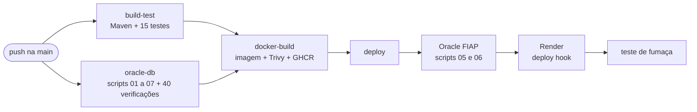
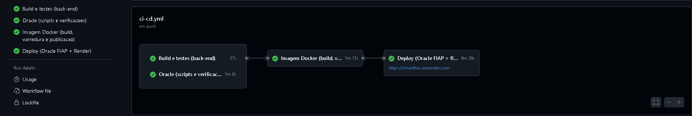
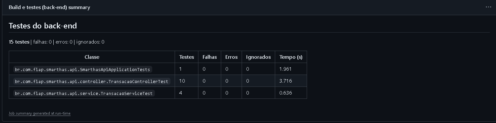
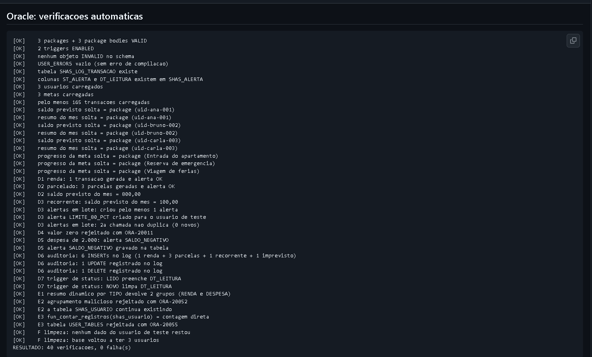
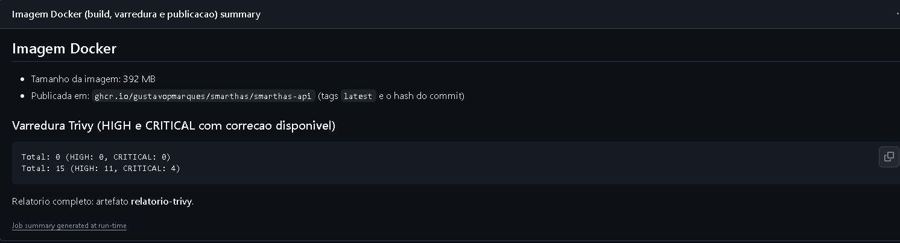
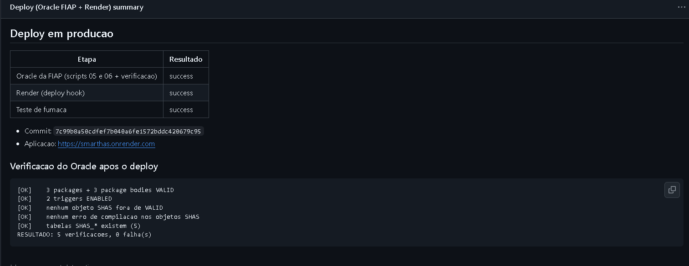

# Pipeline CI/CD do Smart HAS

Pipeline de **Integração e Entrega Contínuas** construído com **GitHub Actions** (`.github/workflows/ci-cd.yml`). A cada push na `main` ele compila e testa o back-end, valida a camada Oracle PL/SQL em um banco descartável, constrói e publica a imagem Docker e faz o deploy automatizado do back-end (Render) junto com os objetos PL/SQL no Oracle da FIAP.

## Por que GitHub Actions

Escolhemos o GitHub Actions porque o código já está no GitHub, não há servidor para instalar e manter, os *secrets* e os ambientes são nativos, e o deploy no Render precisa de um CI acessível pela internet, algo que um Jenkins na máquina local não oferece.

## Visão geral

**Gatilhos:** push e pull request na `main`, além de execução manual (`workflow_dispatch`).

| Job | O que faz | Tempo (execução de referência) |
|---|---|---|
| `build-test` | Compila, executa os 15 testes e gera o `.jar` | 27 s |
| `oracle-db` | Sobe um Oracle Free em container, roda os scripts `01` a `07` e 40 verificações automáticas | 1 min |
| `docker-build` | Constrói a imagem, varre vulnerabilidades (Trivy) e publica no GHCR | 1 min 13 s |
| `deploy` | Aplica os scripts no Oracle da FIAP, dispara o deploy no Render e testa a aplicação | 4 min 38 s |

`build-test` e `oracle-db` rodam **em paralelo**. O `docker-build` só começa se os dois passarem, e o `deploy` só roda em push na `main` depois de tudo passar.

## Como o pipeline atende ao enunciado

| Requisito | Onde está |
|---|---|
| Build e testes automatizados | Job `build-test` (`./mvnw verify`, 15 testes JUnit) e job `oracle-db` (40 verificações sobre packages, triggers e Dynamic SQL) |
| Deploy automatizado do back-end | Job `deploy`: deploy hook do Render e teste de fumaça na URL pública |
| Integração com o banco Oracle | Job `oracle-db` (banco descartável, a cada execução) e job `deploy` (scripts `05` e `06` aplicados no Oracle da FIAP, com verificação somente leitura) |
| Logs e relatórios de execução | Resumo formatado de cada job, log de cada script SQL e 5 artefatos para download (ver abaixo) |

## Detalhe dos jobs

### 1. `build-test`: build e testes do back-end

- Java 21 (Temurin) com cache do Maven.
- `./mvnw -B -ntp verify`: compila, executa os testes e empacota o `.jar`.
- Gera uma **tabela de resultados** por classe de teste no resumo do run.
- Artefatos: `relatorios-testes-backend` (relatórios do Surefire e `mvn-verify.log`) e `smarthas-api-jar`.

### 2. `oracle-db`: camada Oracle em um banco descartável

- Sobe o container `gvenzl/oracle-free:23-slim-faststart` com senhas descartáveis (o banco só existe durante o job).
- O script `database/ci/run_ci.sh` espera o banco ficar pronto, copia a pasta `database/`, executa os scripts `01` a `07` pelo SQL\*Plus e grava **um log por script**.
- O script `database/ci/assert_oracle.sql` **reprova o pipeline** se alguma verificação falhar. Ele confere:
  - 3 packages + 3 bodies `VALID`, 2 triggers `ENABLED`, nenhum objeto inválido e `USER_ERRORS` vazio;
  - a carga de dados;
  - equivalência entre as rotinas soltas e os packages;
  - um cenário completo (registro simples, parcelado e recorrente, alertas sem duplicar, saldo negativo, as duas triggers e o Dynamic SQL, inclusive com entradas maliciosas), com limpeza no final.
- Artefato: `logs-oracle`.

### 3. `docker-build`: imagem, varredura e publicação

- Constrói o `Dockerfile` do back-end (valida o Dockerfile a cada execução), com cache.
- **Trivy** varre vulnerabilidades HIGH e CRITICAL com correção disponível. É informativo e **não bloqueia** o pipeline.
- Em push na `main`, publica a imagem no GitHub Container Registry: `ghcr.io/gustavopmarques/smarthas/smarthas-api` (tags `latest` e o hash do commit).
- Artefato: `relatorio-trivy`.

### 4. `deploy`: Oracle da FIAP e Render

Roda no ambiente `production` (com *secrets* próprios) e **nunca cancela** um deploy em andamento.

1. **Oracle da FIAP:** testa a conexão, aplica os scripts `05_packages.sql` e `06_triggers.sql` (ambos reexecutáveis) e roda `database/ci/verify_deploy.sql`, uma verificação **somente leitura**. Se algo falhar, o back-end **não** é implantado, para banco e aplicação ficarem consistentes. Os scripts `01` e `02` não rodam aqui, porque recriam tabelas e recarregam dados.
2. **Render:** dispara o *deploy hook*.
3. **Teste de fumaça:** aguarda a aplicação responder (qualquer resposta abaixo de 500 prova que o serviço está de pé).
4. Resumo do deploy e artefato `logs-deploy-oracle`.

## Logs e relatórios de execução

| Onde | O que contém |
|---|---|
| Log de cada *step* (aba Actions) | Saída completa, com os scripts SQL agrupados |
| Resumo do `build-test` | Tabela de testes por classe: total, falhas, erros e tempo |
| Resumo do `oracle-db` | Lista das 40 verificações (`[OK]` ou `[FALHA]`) e o resultado final |
| Resumo do `docker-build` | Tamanho da imagem, onde foi publicada e o resultado do Trivy |
| Resumo do `deploy` | Resultado de cada etapa, commit, URL e verificação do Oracle |
| Artefato `relatorios-testes-backend` | Relatórios do Surefire (XML) e log do Maven |
| Artefato `smarthas-api-jar` | O `.jar` gerado |
| Artefato `logs-oracle` | Um log por script SQL do banco descartável |
| Artefato `relatorio-trivy` | Relatório completo de vulnerabilidades |
| Artefato `logs-deploy-oracle` | Logs da aplicação dos scripts no Oracle da FIAP |

## Evidências

Execução de referência, 100% verde:

*Os quatro jobs encadeados. O deploy publica em https://smarthas.onrender.com.*

*Job `build-test`: 15 testes, sem falhas nem erros.*

*Job `oracle-db`: 40 verificações, 0 falhas.*

*Job `docker-build`: imagem de 392 MB publicada no GHCR e resultado da varredura.*

*Job `deploy`: Oracle da FIAP, Render e teste de fumaça com sucesso, mais a verificação pós-deploy do banco.*

## Segurança e boas práticas

- **Nenhuma credencial no código.** `ORACLE_USER`, `ORACLE_PASSWORD` e `RENDER_DEPLOY_HOOK_URL` ficam em *secrets* do ambiente `production`. As senhas do banco descartável existem só durante o job.
- **Permissões mínimas:** o workflow usa `contents: read`, e só o job de imagem recebe `packages: write`.
- **Deploy só na `main`** e só depois de testes, Oracle e imagem passarem. Pull requests nunca publicam nem fazem deploy.
- **Concorrência controlada:** um run novo cancela o anterior apenas em pull request, e nunca interrompe um deploy.
- **DevSecOps:** varredura Trivy da imagem a cada execução.

## Como configurar

1. **Render:** em *Settings*, deixe **Auto-Deploy** em *Off* (o pipeline é quem decide quando publicar) e copie a URL do **Deploy Hook**.
2. **GitHub:** em *Settings > Environments*, crie o ambiente `production` com os *secrets* `RENDER_DEPLOY_HOOK_URL`, `ORACLE_USER` e `ORACLE_PASSWORD`.
3. **Variáveis opcionais** (*Settings > Secrets and variables > Actions > Variables*):

| Variável | Padrão | Para que serve |
|---|---|---|
| `APP_URL` | `https://smarthas.onrender.com` | URL usada no teste de fumaça |
| `ORACLE_HOST` / `ORACLE_PORT` / `ORACLE_SID` | `oracle.fiap.com.br` / `1521` / `ORCL` | Conexão com o Oracle da FIAP |
| `ORACLE_DEPLOY` | `true` | `false` pula a etapa do Oracle e faz só o Render |

## O que o pipeline já provou na prática

- **Detectou um problema real:** a primeira execução do `oracle-db` reprovou a verificação "nenhum objeto inválido". O `ALTER TABLE` em `SHAS_ALERTA` (script `06`) deixava as rotinas dependentes como `INVALID` até a próxima chamada. A correção foi recompilar os dependentes no próprio script, e o pipeline passou a garantir isso a cada execução.
- **Diferenças de ambiente:** os scripts rodam tanto no SQL Developer quanto no SQL\*Plus e no SQLcl, em Oracle Free 23ai (CI) e no Oracle da FIAP (deploy).

